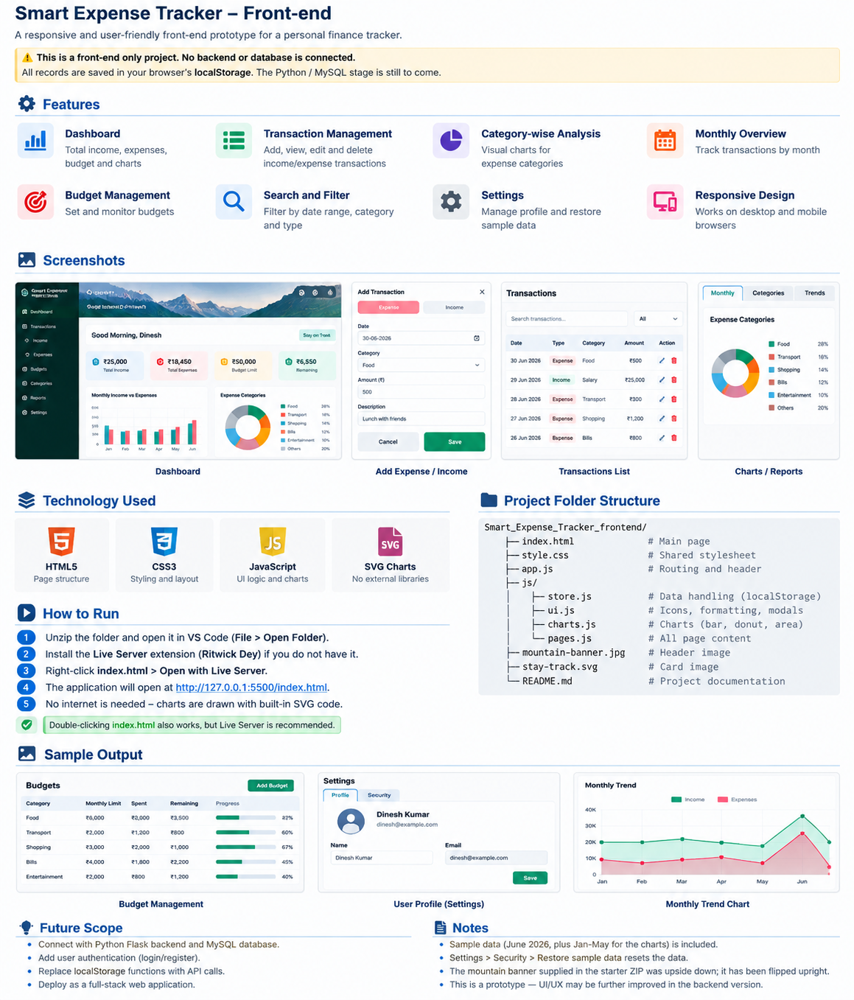

# Smart Expense Tracker

A web-based personal finance application for tracking income, expenses, budgets, and transaction history through a dashboard with charts and reports.

> **Project status:** The repository contains a Flask/Python backend and a browser-based frontend. Configure your local MySQL connection before running the full application. Never commit your real `.env` file, database password, secret key, or other credentials.

## Project Overview

The application is designed to help users:
- Register, log in, and log out securely.
- Record and manage income and expenses.
- View, edit, and delete transactions.
- Organize transactions by category and date.
- Set and review budgets.
- View dashboard summaries and charts.
- Keep each account's data separate.

## Project Overview Image



*Note: The overview graphic is an illustrative UI summary. Some text in the graphic describes an earlier front-end prototype; follow the actual project code and setup instructions below for the current application.*

## Technology Stack

- **Frontend:** HTML, CSS, JavaScript
- **Backend:** Python, Flask
- **Database:** MySQL
- **Charts/UI:** JavaScript and SVG/chart components used by the frontend
- **Development environment:** Visual Studio Code

## Project Structure

```text
Smart_Expense_Tracker/
├── app.py
├── app.js
├── index.html
├── style.css
├── database.sql
├── requirements.txt
├── .env.example
├── .gitignore
├── README.md
├── README_BACKEND.md
├── js/
│   ├── charts.js
│   ├── pages.js
│   ├── store.js
│   └── ui.js
├── templates/
│   ├── login.html
│   └── register.html
├── assets/
│   └── smart-expense-tracker-overview.png
├── mountain-banner.jpg
└── stay-track.svg
```

*Your exact folder contents may vary slightly depending on the current version of the project.*

## Requirements

Install the following before running the application:

- Python 3.12 recommended
- MySQL Server
- MySQL Workbench (optional, useful for database management)
- Visual Studio Code (recommended)

Check your Python installation:

```powershell
python --version
```

Check that Git is installed:

```powershell
git --version
```

## Setup and Run in VS Code

### 1. Open the project

Open Visual Studio Code, select **File → Open Folder**, and choose the project root folder—the folder containing `app.py` and `requirements.txt`.

### 2. Create and activate a virtual environment

Run these commands in the VS Code PowerShell terminal from the project root:

```powershell
python -m venv .venv
.\.venv\Scripts\Activate.ps1
```

If PowerShell blocks activation, you can use Command Prompt instead:

```bat
.venv\Scripts\activate.bat
```

### 3. Install Python dependencies

```powershell
python -m pip install --upgrade pip
python -m pip install -r requirements.txt
```

### 4. Configure environment variables

Create a local `.env` file in the project root. Use `.env.example` as a guide and fill in your own local values:

```env
DB_HOST=localhost
DB_PORT=3306
DB_USER=root
DB_PASSWORD=YOUR_MYSQL_PASSWORD
DB_NAME=smart_expense_tracker
SECRET_KEY=YOUR_RANDOM_SECRET_KEY
```

Replace the placeholders with your own values. **Do not upload `.env` to GitHub.** The `.gitignore` file should exclude it.

### 5. Prepare the MySQL database

1. Start MySQL Server.
2. Open MySQL Workbench or your preferred MySQL client.
3. Create/use the database named `smart_expense_tracker`.
4. If this is a fresh installation, review `database.sql` and run the required schema setup.
5. If you already have project data in the database, do **not** rerun a destructive setup script or drop existing tables. Back up your database before making schema changes.

Make sure the database name and credentials in `.env` match your local MySQL setup.

### 6. Start the Flask application

From the project root, with the virtual environment active, run:

```powershell
python app.py
```

Keep the terminal open while using the application. Open the local URL printed by Flask. In the current setup, the login page is typically:

```text
http://127.0.0.1:5000/login
```

If that address does not load, check the URL printed in the terminal and review any startup error messages.

## Common Commands

Run these from the project root in the VS Code terminal.

| Purpose | Command |
|---|---|
| Create virtual environment | `python -m venv .venv` |
| Activate in PowerShell | `.\.venv\Scripts\Activate.ps1` |
| Install dependencies | `python -m pip install -r requirements.txt` |
| Run the app | `python app.py` |
| Check changed files | `git status` |
| Stage project changes | `git add .` |
| Commit changes | `git commit -m "Describe your changes"` |
| Push to GitHub | `git push` |

Before running `git add .`, verify that `.env`, `.venv/`, local database files, and secrets are ignored.

## GitHub Workflow

After making changes to the project:

```powershell
git status
git add .
git status
git commit -m "Update Smart Expense Tracker"
git push
```

Review the second `git status` output before committing. Do not commit `.env` or credentials. If a secret has ever been pushed to a remote repository, changing or deleting the file alone is not enough—rotate the exposed credential.

## Frontend-Only Preview

The frontend may also be previewed separately with the **Live Server** extension in VS Code:

1. Open the project folder.
2. Right-click `index.html`.
3. Select **Open with Live Server**.

This preview is useful for checking the UI. However, use the Flask URL for testing backend-connected login, transactions, budgets, and other API-backed features. Opening `index.html` directly does not start the Flask backend.

## Troubleshooting

### `python` is not recognized
Install Python and ensure it is added to PATH. Restart VS Code after installation.

### `pip install` fails
Confirm the virtual environment is active and check your internet connection. Read the first error in the terminal; some packages may need a compatible Python version.

### MySQL connection error
Check that MySQL Server is running and verify `DB_HOST`, `DB_PORT`, `DB_USER`, `DB_PASSWORD`, and `DB_NAME` in your local `.env`.

### Login page does not open
Confirm `python app.py` is still running and use the local URL shown by Flask. Look for route or configuration errors in the terminal.

### Git push is rejected
Run `git status` and read the full Git error before trying another command. If the remote repository contains a README or other commit that your local branch does not have, do not use `git push --force` as a first fix.

## Security Notes

- Keep `.env` out of Git.
- Never publish passwords, API keys, secret keys, or private user data.
- Use a strong, unique `SECRET_KEY` for local configuration.
- Do not share database credentials in screenshots or public issue reports.
- Use test data while demonstrating the application.

## Future Improvements

- Add automated tests for authentication and transaction workflows.
- Improve validation and error messages.
- Add deployment configuration for a production environment.
- Add database backups and migration management.
- Improve accessibility and mobile responsiveness.

## License

Add a license file if you intend to distribute or reuse this project publicly. Until a license is added, do not assume that others have permission to reuse the code.
